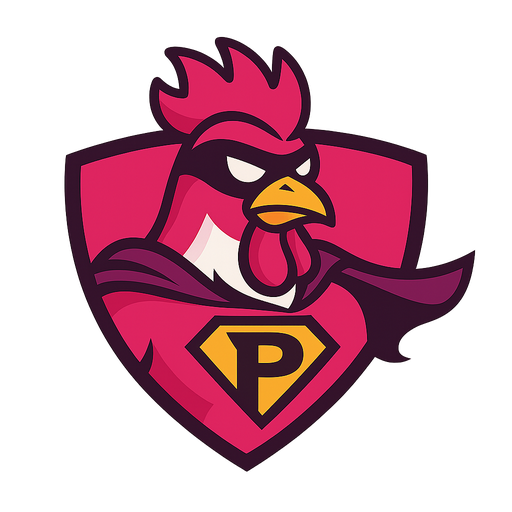

<div align="center">



# PinkRooster.Extensions.AI.Antigravity

**An `IChatClient` for the Antigravity CLI (`agy`): plain text, JSON-schema answers, streaming, images and your own `AIFunction` tools, on .NET 8 and .NET 10.**

[](https://github.com/pinkroosterai/PinkRooster.Extensions.AI.Antigravity/actions/workflows/ci.yml)
[](#compatibility)
[](LICENSE)
[](https://dotnet.microsoft.com/)

[Usage terms](#read-this-first-usage-terms) · [The idea](#the-idea) · [Quickstart](#quickstart) · [Features](#features) · [Options](#options) · [Errors](#errors) · [FAQ](#faq) · [Contributing](#development-and-license)

</div>

---

PinkRooster.Extensions.AI.Antigravity is a .NET library that implements [`IChatClient`](https://learn.microsoft.com/dotnet/ai/microsoft-extensions-ai)
from Microsoft.Extensions.AI on top of the Antigravity CLI, `agy`, Google's successor to the Gemini CLI. You keep the `IChatClient` pipeline you
already know: middleware, `GetResponseAsync<T>`, dependency injection. The library adds:

- **One request, one `agy` run.** Each request starts `agy` once in non-interactive print mode, in a new empty directory, and maps its JSON output to a `ChatResponse`.
- **Structured output.** `ChatResponseFormat.ForJsonSchema` and `GetResponseAsync<T>`, checked against your schema.
- **Streaming.** Incremental text for plain-text requests.
- **Tools.** Your `AIFunction`s run in your process, called by `agy` through a private loopback MCP bridge.
- **Images.** `DataContent` (png, jpeg, gif, webp) in user messages.
- **Isolation.** On Linux every request gets its own throwaway agy home, so your agy rules, settings and MCP servers stay out of it.

One NuGet package, `PinkRooster.Extensions.AI.Antigravity`. The only dependencies are Microsoft.Extensions.AI.Abstractions (10.3.0 or newer), logging, options, DI abstractions and a JSON schema validator.

## Read this first: usage terms

The library wraps the `agy` command line. Google's Antigravity terms and FAQ (read 2026-10-16; neither page shows a date) say:

- Additional Terms §6: "Using third party software, tools, or services to access the Service (e.g. using OpenClaw with Antigravity OAuth) is a breach of this Agreement", which "may be grounds for suspension or termination" of your account.
- FAQ: headless mode (`agy -p`) "is intended for direct scripting and CI workflows"; wrapping `agy` inside third-party coding agents or applications "is not supported under consumer plans". For third-party agents the FAQ recommends a Gemini Enterprise or Google AI Studio API key.

The library does not check which plan you use. **You are responsible for complying with the terms of your plan.** For anything beyond personal scripting, use an API key or Enterprise sign-in as Google recommends. The library never handles credentials: it does not sign in, read token files or change agy's settings. You sign in with `agy` yourself.

## The idea

`agy` is an agent, not a model endpoint. It reads and writes files, runs commands, calls MCP servers and browses. A chat client must not cause side effects you did not ask for, and a plain wrapper around the CLI does. This library puts a chat-client contract around the agent, and is explicit about where the contract holds and where it does not:

| Layer | What the library does |
|---|---|
| Working directory | A new empty directory per request, deleted afterwards (owner-only where the platform allows) |
| Permissions | Never auto-approves, never adds directories, resumes conversations or selects a mode; agy keeps its headless defaults |
| Prompt | Starts with an instruction not to use tools or write files (`SystemPreamble`); slash commands are switched off |
| Agy home (Linux) | A per-request `HOME`; system text travels in `AGENTS.md`, off the command line |
| Success | Exit code 0 is not success: the envelope `status` must be `SUCCESS` and there must be no timeout notice |

The [limits](#what-the-library-cannot-prevent) are listed below, not hidden.

## Quickstart

You need .NET 8 or .NET 10 and the Antigravity CLI **1.3.5 or newer**, installed and signed in once (start `agy` interactively). The library checks the version once per client; an older version raises `AntigravityVersionException`.

```text
dotnet add package PinkRooster.Extensions.AI.Antigravity
```

(Once published.)

```csharp
using Microsoft.Extensions.AI;
using PinkRooster.Extensions.AI.Antigravity;

using IChatClient client = new AntigravityChatClient(new AntigravityChatClientOptions
{
    DefaultModelId = "gemini-3.8-flash-low", // see `agy models`
});

ChatResponse reply = await client.GetResponseAsync("Say pong.");
Console.WriteLine(reply.Text);
```

A typed answer:

```csharp
public record Weather(string City, double TemperatureCelsius);

ChatResponse<Weather> typed = await client.GetResponseAsync<Weather>("Weather in Paris, made up is fine.");
Console.WriteLine(typed.Result.City);
```

With dependency injection and middleware:

```csharp
services.Configure<AntigravityChatClientOptions>(configuration.GetSection("Antigravity")); // optional
services.AddAntigravityChatClient(o => o.DefaultModelId = "gemini-3.8-flash-low");

IChatClient client = provider.GetRequiredService<IChatClient>();
using IChatClient withMiddleware = client.AsBuilder().UseOpenTelemetry().Build();
```

Use `Microsoft.Extensions.AI` in your app for `GetResponseAsync<T>` and pipelines. [`samples/ConsoleSample`](samples/ConsoleSample/Program.cs) is a short tour; it is built with the solution but never run by the build, because every run spends model tokens.

## Features

| I want to… | Use | Details |
|---|---|---|
| Get a text answer | `GetResponseAsync` | [Results](#results) |
| Get a typed or schema-checked answer | `ChatResponseFormat.ForJsonSchema`, `GetResponseAsync<T>` | [Structured output](#structured-output) |
| Show text as it is written | `GetStreamingResponseAsync` | [Streaming](#streaming) |
| Let agy call my C# functions | `ChatOptions.Tools` with `AIFunction`s | [Tools](#tools) |
| Ask about an image | `DataContent` in a user message | [Messages and images](#messages-and-images) |
| Keep my own agy setup out of requests | `IsolateAgyHome` (Linux, on by default) | [Isolated agy home](#isolated-agy-home) |
| Choose model and reasoning effort | `ModelId`, `Reasoning` | [`ChatOptions`](#what-each-chatoptions-member-does) |

### Structured output

With `ChatResponseFormat.ForJsonSchema` (and `GetResponseAsync<T>`), the schema is written to a file in the request directory and agy returns a structured result. The library returns that result, **not** agy's free-text answer (which carries extra fields), as compact JSON, after checking it against your schema.

- The schema must be an object schema (`"type": "object"`). `GetResponseAsync<T>` wraps primitives, arrays and enums in an object with a `data` property and unwraps them.
- Draft 2020-12 applies unless the schema declares draft 7 or 2019-09.
- If agy cannot satisfy the schema it still reports success but returns no structured result; the library raises `AntigravityInvalidOutputException` (the raw text is on `RawOutput`, not in the message). The same happens when the result does not match your schema. There is no retry.
- **Not asserted:** `format` is an annotation only (dates and GUIDs are not checked); `contentEncoding` and `contentMediaType` are not decoded or checked; remote `$ref` documents are never fetched; keywords the validator does not know are ignored. Defects in a schema usually raise `ArgumentException` before agy runs; a bad regular expression or an unresolvable `$ref` raises it only when an answer reaches it, after one run.
- `ChatResponseFormat.Json` (no schema): the answer, with one surrounding Markdown code fence removed, must be exactly one JSON value, else `AntigravityInvalidOutputException`.

### Streaming

`GetStreamingResponseAsync` for a plain-text request runs agy with `stream-json` output and yields the answer text as agy writes it: one update per piece of text, then a final update with usage, `ResponseId`, `ModelId`, `FinishReason` and `AdditionalProperties` and no text.

- The text of every answer step is streamed, so when agy writes text between its own tool calls the joined text can be longer than `GetResponseAsync`'s.
- A request with a JSON response format yields the whole checked answer as **one** update, because it can only be checked when complete.
- Errors surface on a `MoveNextAsync` call: the first one when nothing was yielded yet, a later one when agy fails after text was sent (the text already yielded stands; nothing is retried).
- Stopping the enumeration early ends the agy process. A timeout is only visible once the run ends; the stream carries no event for it.

### Tools

Pass `AIFunction` tools in `ChatOptions.Tools` and agy can call them while it works on the request:

```csharp
var options = new ChatOptions { Tools = [AIFunctionFactory.Create((string city) => GetForecast(city), "forecast")] };
ChatResponse response = await client.GetResponseAsync("Will it rain in Utrecht?", options);
```

For the request the library opens a private endpoint on `127.0.0.1` (random port, random token, valid only for that request), tells agy about it through the request's own agy home, and runs your function in your process whenever agy calls it. The answer comes back as text; **no tool call is returned to you**, so a surrounding `FunctionInvokingChatClient` never runs a tool itself and `FunctionCallContent` never appears in a response or in streamed updates.

- **Requires `IsolateAgyHome`** (Linux): tool requests are refused where the home is not isolated.
- **No approval step.** agy decides when to call a tool, with arguments the model chose (checked against the tool's JSON schema first). A tool with side effects runs whenever the model asks for it. Treat tool results as untrusted input to the model.
- **`MaxToolCalls`** (default 20) limits the calls per request; further calls get an error result and agy decides what to do.
- A tool that throws gives agy a generic error ("The tool failed.") and is not rethrown to you. Tool arguments and results are never logged; tool names and durations are, at debug level.
- agy may call several tools at the same time; your functions must be safe to run concurrently.
- Cancelling the request, or reaching `Timeout`, ends agy and cancels the token your function received. A tool that takes minutes needs a larger `Timeout`.
- Not supported yet: tools together with a JSON response format, approval-required tools, `RequireAny`/`RequireSpecific`.

### Isolated agy home

On Linux every request runs agy with its own throwaway home directory (`HOME`), created next to the request directory and deleted with it (`IsolateAgyHome`, on by default). The system text (`SystemPreamble`, system messages, `Instructions`) travels in an `AGENTS.md` file in the request directory instead of the prompt, so it also stays off the command line; a system text over 24,000 bytes is refused, because agy truncates a longer rule file.

- agy does not see your own agy rules (`GEMINI.md`/`AGENTS.md` in your home), skills, plugins, settings or MCP servers. Before this, a global rule file could add text to every answer (a suffix rule was seen in a test) and cost about 5,000 input tokens (indicative).
- Nothing of a request stays in agy's history; the home is deleted afterwards.
- Cost: about 18 MB is written per request (agy unpacks a binary into a fresh home); run time was unchanged in the one test.
- Your sign-in is not stored in the home (verified once on Linux: an empty `HOME` was still signed in). If you sign in with an API key or Application Default Credentials through agy settings, that is untested: set `IsolateAgyHome` to `false`.
- On Windows and macOS isolation is not applied; the option has no effect there until it is verified.

### Messages and images

System, user and assistant messages become one prompt: a preamble, then the system text, then the turns in order, each under a header with a random per-request code so that text in a message cannot pose as a turn. Text is passed unchanged. Reasoning content in history is dropped. A prompt reaches agy as one command-line argument, without a shell.

Images (`DataContent` of type png, jpeg, gif or webp in user messages, at most 10 of 10 MiB each) are written as files in the request directory and the prompt points agy at them. agy 1.4.0 was seen reading a jpeg this way; png, gif and webp are unchecked. URIs, other files and tool calls or results raise `NotSupportedException`.

### What the library cannot prevent

- **Your MCP servers run on every request** unless `IsolateAgyHome` applies. agy starts every MCP server enabled in your agy settings (four `npx` processes on the test machine) and the model can call their tools. The library does not read or change agy's settings; use `agy mcp list` and `agy mcp disable` yourself.
- **Your agy settings can widen permissions** unless `IsolateAgyHome` applies. Allow-rules for commands or file writes in agy's `settings.json` apply to requests made through this library.
- **agy stores a transcript of every request**, including the full prompt and answer, under `~/.gemini/antigravity-cli/brain/`, unless `IsolateAgyHome` applies.
- **The prompt is visible in the process list** while agy runs, because agy takes the prompt only as a command-line argument. (System text is not, with `IsolateAgyHome`.)
- **Writes outside the request directory are not blocked.** `--sandbox` did not stop agy from writing files in its working directory, so the library relies on the throwaway directory.
- The preamble that asks agy not to use tools is an instruction to a model, not enforcement.

## Cost and speed

- Every request costs at least about 17,000 input tokens of agy's own overhead (a one-word answer used 16,878 on agy 1.3.5). `Usage` reports what agy reports, overhead included.
- A trivial request took 2 to 12 seconds with agy 1.3.5. The library's process handling adds about 1 ms over starting the process by hand (measured on Linux with a fake agy).
- One agy model call per request. No retries, no warm-up, and the version check does not call a model.
- `ChatOptions.MaxOutputTokens` is not honored, so it cannot cap cost.

## Options

`AntigravityChatClientOptions` is validated and copied when the client is created; later changes to the instance have no effect.

| Option | Default | Meaning |
|---|---|---|
| `ExecutablePath` | null | Path of agy. Null: the `PATH`, then `~/.local/bin` (Windows: `%LOCALAPPDATA%\agy\bin`). Batch files (`.cmd`, `.bat`) are refused. |
| `DefaultModelId` | null | Model used when the request names none. Null leaves it to agy. |
| `DefaultReasoningEffort` | null | Used when the request names none; see `Reasoning` below. |
| `Timeout` | 5 minutes | Longest a request may run (at least 1 second). Waiting for a free slot does not count. |
| `MaxConcurrency` | 4 | Most agy processes one client runs at once. |
| `MaxPromptLength` | 100,000 (Windows 30,000) | Longest prompt in characters. A platform limit in bytes also applies; the smaller wins. Over it: `AntigravityPromptTooLargeException`, nothing runs. |
| `SkipVersionCheck` | false | Skips `agy --version`. |
| `EnvironmentVariables` | empty | Added to the host environment for agy; a null value removes a variable. May not set `HOME` while `IsolateAgyHome` applies. |
| `TemporaryDirectoryRoot` | system temp | Where request directories are created. |
| `AdditionalArguments` | empty | Extra agy arguments. Flags the library sets or that break safety (`-p`, `--output-format`, `--input-format`, `--json-schema`, `--print-timeout`, `--model`, `--effort`, `--disable-slash-commands`, `--dangerously-skip-permissions`, `--add-dir`, `-c`/`--continue`, `--conversation`, `--mode`, `--project`, `--new-project`, `-i`/`--prompt-interactive`, `--agent`) raise `ArgumentException` when the client is created. |
| `SystemPreamble` | built-in text | Placed at the start of every prompt. Must not be empty. |
| `MaxOutputBytes` | 16 MiB | Most standard output read; more raises `AntigravityOutputException`. |
| `MaxToolCalls` | 20 | Most tool calls agy may make in one request; further calls get an error result. At least 1. See [Tools](#tools). |
| `IsolateAgyHome` | true on Linux, false elsewhere | Per-request throwaway agy home and `AGENTS.md`. Writes about 18 MB per request. Linux only; `true` elsewhere has no effect. See [Isolated agy home](#isolated-agy-home). |

### What each `ChatOptions` member does

Honored: `ModelId`, `ResponseFormat`, `Instructions`, `Reasoning`, and `Tools` with `ToolMode` null, auto or none. Everything else is ignored, and a debug log entry names (never shows) the ones you set. The unsupported tool cases are rejected.

| Member | Behavior |
|---|---|
| `ModelId` | Passed to agy as the model; falls back to `DefaultModelId`, then agy's default. An unknown model raises `AntigravityProcessException`. |
| `ResponseFormat` | `Text`: plain. `Json`: the answer must be one JSON value. `ForJsonSchema`: see [Structured output](#structured-output). |
| `Instructions` | Added to the system text of the prompt, after any system messages. |
| `Reasoning` | `Effort` maps `Low`→low, `Medium`→medium, `High`→high, `ExtraHigh`→xhigh; `None` passes nothing; `Output` is ignored. agy rejects an effort together with a model name that already ends in `-low`, `-medium`, `-high`, `-xhigh` or `-max` (such as `gemini-3.8-flash-low`), so then the effort is **not passed** (debug log). Use a base name such as `gemini-3.8-flash` with an effort. |
| `Tools`, `ToolMode` | `AIFunction` tools are offered to agy through a private endpoint (see [Tools](#tools)). Refused with `NotSupportedException` before anything runs: approval-required, declaration-only and hosted tools, `RequireAny` and `RequireSpecific`, tools together with a JSON response format, and any tools while `IsolateAgyHome` does not apply. Two tools with the same name raise `ArgumentException`. `ToolMode.None` runs a plain request. |
| `Temperature`, `TopP`, `TopK`, `Seed`, `FrequencyPenalty`, `PresencePenalty` | Ignored: agy has no such settings. |
| `StopSequences`, `MaxOutputTokens` | Ignored: do not rely on them for limits or cost. |
| `ConversationId`, `ContinuationToken`, `AllowBackgroundResponses` | Ignored: the client is stateless and sends the whole conversation every time. |
| `AllowMultipleToolCalls`, `RawRepresentationFactory`, `AdditionalProperties` | Ignored. |

### Results

`ChatResponse` has one assistant message. `ResponseId` is agy's conversation id; `ModelId` is the model you chose (null when none); `FinishReason` is always `Stop` on success; `Usage` maps agy's token counts (input, output, total, cached input, reasoning). `RawRepresentation` is agy's JSON (`JsonElement`), and `AdditionalProperties` has `agy.num_turns`, `agy.duration_seconds` and, when agy denied something, `agy.denied_actions`.

`GetService` returns `ChatClientMetadata` (provider `antigravity`, your default model) for `typeof(ChatClientMetadata)`, and the client itself for `typeof(AntigravityChatClient)`.

## Errors

| Exception | When |
|---|---|
| `AntigravityNotFoundException` | agy was not found; lists where it looked. |
| `AntigravityVersionException` | agy is older than 1.3.5, or its version could not be read. |
| `AntigravityNotAuthenticatedException` | agy says it is not signed in. Detection uses the text the official documentation gives ("authentication required"); the real wording has not been captured, so another wording shows as one of the two exceptions below. |
| `AntigravityTimeoutException` | The request exceeded `Timeout`, or agy reported its own print timeout. agy reports its timeout as a success with an empty answer; the library does not. |
| `AntigravityProcessException` | agy ended with a non-zero exit code (bad model, bad flag, killed from outside), or could not be started. |
| `AntigravityRunException` | agy exited with 0 but did not succeed: status other than `SUCCESS` (a content-safety block, for instance, also when a structured result is present), or no answer because agy denied an action. |
| `AntigravityOutputException` | agy's output was not the expected JSON, or exceeded `MaxOutputBytes`. |
| `AntigravityInvalidOutputException` | The structured result is missing, or does not match the schema or JSON format. |
| `AntigravityPromptTooLargeException` | The prompt is over a size limit. |
| `ArgumentException`, `ArgumentNullException`, `NotSupportedException`, `ObjectDisposedException`, `OperationCanceledException` | Bad input or options, unsupported content or options, use after `Dispose`, cancellation. |

Messages never contain the prompt, the answer, the schema or environment values. `StandardError` (up to 4 KB) and `ExitCode` are on the exception, and `RawOutput` on `AntigravityInvalidOutputException`; treat them as sensitive. Cancelling a request ends the whole agy process tree and deletes the request directory; a request waiting for a free slot can be cancelled without starting anything.

### Logging

Pass an `ILogger<AntigravityChatClient>` (or register one for dependency injection). Entries contain only model names, durations, token counts, prompt length, versions, option names, exit codes and exception type names. Prompts, answers, schemas, standard error, environment values, tool arguments and results, and credentials are never logged. The library does not log at error level; exceptions carry the information.

## Compatibility

| agy | Platform | Status |
|---|---|---|
| 1.3.5 | Linux (Ubuntu) | agy's behavior was verified by hand, and the library is tested against a fake agy (`tools/PinkRooster.Extensions.AI.Antigravity.FakeAgy`). |
| 1.4.0 and newer | any | Accepted; one information log entry. Image input seen working with a jpeg (on 1.4.0, Linux). |
| older than 1.3.5 | any | Rejected. |
| any | Windows, macOS | Run in CI with a fake agy; **unverified** with the real CLI (process-tree kill, argument limits, UTF-8 output). |

Where agy's documentation and its behavior disagree, the library follows the behavior: agy's default print timeout is unlimited, not five minutes, a timeout exits with 0, and a prompt cannot be read from standard input. The library only passes flags verified on 1.3.5 or 1.4.0 and ignores envelope fields it does not know.

**Not supported in 0.1.0:** streaming of tool steps and of JSON-format answers, audio, video, files and image URIs, embeddings, conversation reuse, choosing the working directory, retrying invalid structured output, and agy's own agent, mode and permission settings. [`docs/deferred.md`](docs/deferred.md) says how each could be added.

## FAQ

**Is this allowed by Google's terms?** That depends on your plan; see [Read this first](#read-this-first-usage-terms). The library does not check, and you are responsible.

**Does it work on Windows or macOS?** It builds and its tests run there against a fake agy, but it is unverified with the real CLI. Isolation, and with it tools, is Linux only for now.

**Why does a one-word answer cost 17,000 tokens?** That is agy's own overhead (system prompt, tool definitions). The library cannot reduce it; `Usage` reports it honestly.

**Can I use it with `FunctionInvokingChatClient`?** For reading responses, yes, but it will never see a tool call: agy calls your `AIFunction`s itself, through the bridge, and returns text.

**Can I make agy ask before it runs a tool?** No. There is no approval step; approval-required tools are refused with `NotSupportedException`.

**Does the library log my prompts?** Never. See [Logging](#logging).

## Development and license

You need the .NET 10 SDK. From the repository root:

```text
dotnet build PinkRooster.Extensions.AI.Antigravity.sln -warnaserror
dotnet test tests/PinkRooster.Extensions.AI.Antigravity.Tests
dotnet test tests/PinkRooster.Extensions.AI.Antigravity.ProcessTests
dotnet pack src/PinkRooster.Extensions.AI.Antigravity -c Release
```

The unit and process tests need no agy, model or network. The `net8.0` tests run in CI only. A suite against a real agy spends tokens, is not part of CI, and is run by the maintainer before a release.

Where to read more: [`docs/specification.md`](docs/specification.md) (requirements), [`docs/software-design.md`](docs/software-design.md) (design), [`docs/how-it-works.md`](docs/how-it-works.md) (the whole flow in prose) and [`docs/deferred.md`](docs/deferred.md) (out of scope, with extension notes).

Found a bug or missing something? [Open an issue](https://github.com/pinkroosterai/PinkRooster.Extensions.AI.Antigravity/issues). The code is under the MIT terms in [LICENSE](LICENSE).
