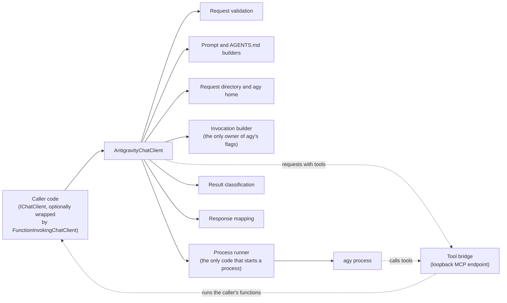
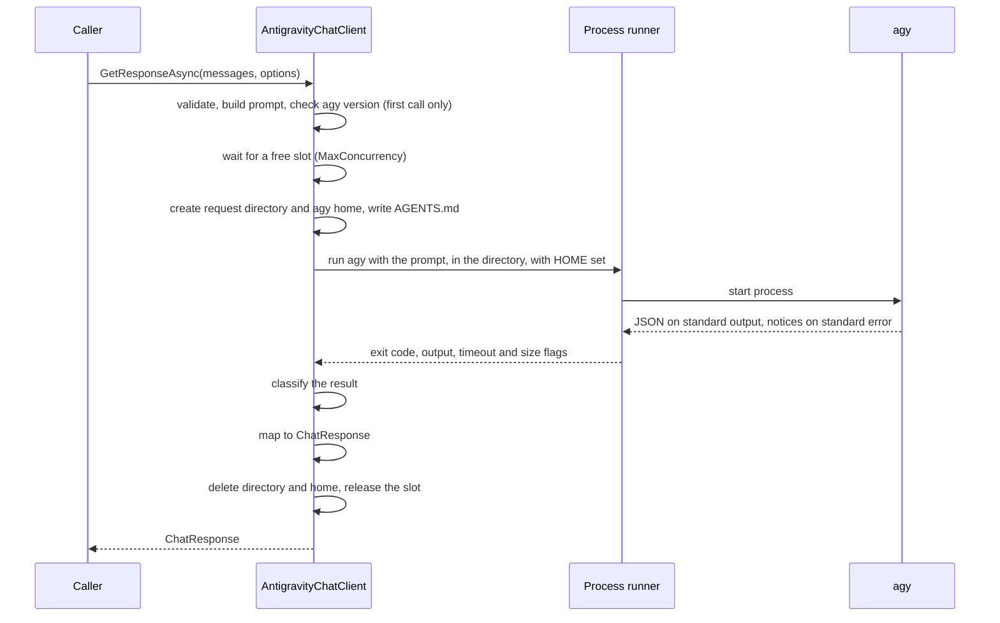
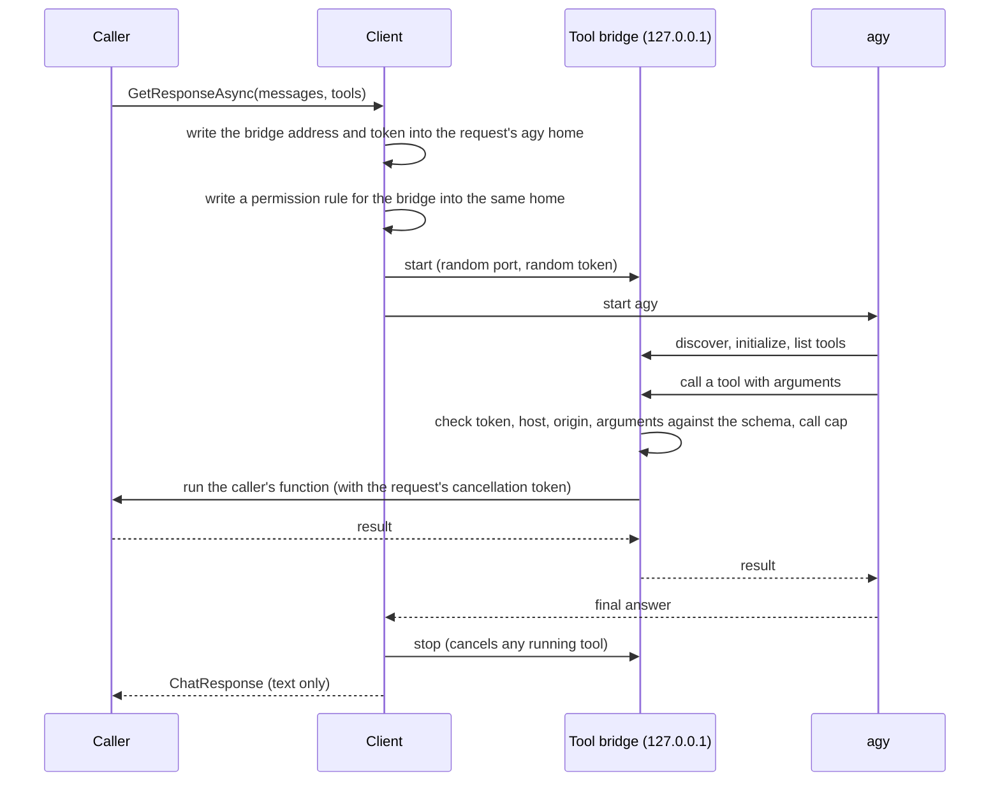
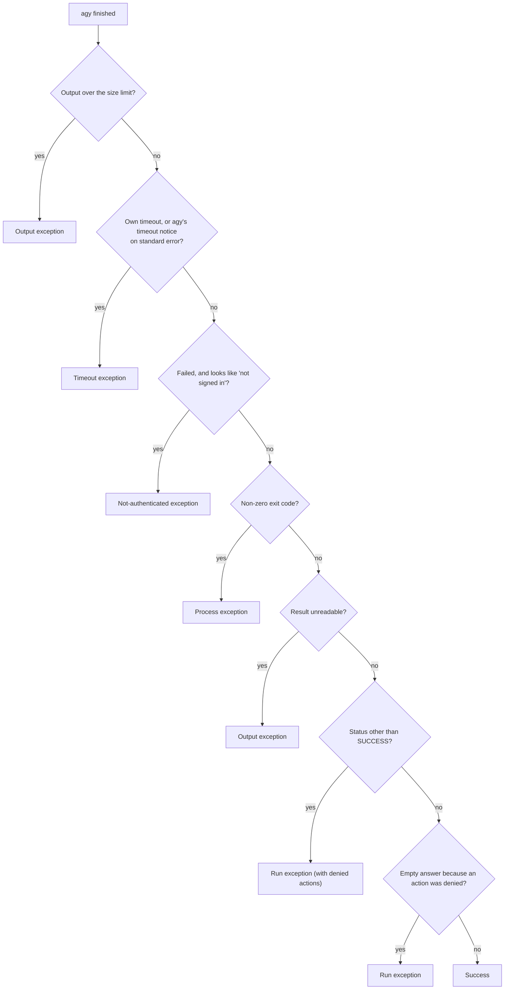

# How the Antigravity chat client works

This describes `AntigravityChatClient`, the `IChatClient` that answers each request by running the Antigravity CLI (`agy`) once. It is a reading guide, not a specification: the requirements are in `specification.md`, the design decisions in `software-design.md`, and the features added later in `streaming-responses/spec.md` and `tool-calling-mcp-bridge/spec.md`. The mermaid diagrams could not be rendered while this file was written.

## 1. The idea in one paragraph

The client does not talk to a model API. For every call it starts the `agy` command-line tool in print mode, in a new empty directory, waits for it to finish, and turns agy's output into the usual `ChatResponse` (or a stream of `ChatResponseUpdate`s). Nothing is kept between calls: no process, no conversation, no connection. Every call resends the whole conversation. On Linux each call also gets its own throwaway agy home, so agy sees none of the user's own agy configuration.

## 2. The pieces



| Piece | Job |
|---|---|
| Client | Orders the steps of a request and owns the concurrency limit. Thread-safe; keeps no per-request state. |
| Request validation | Checks messages, roles, content types, tools, tool mode and response format before anything starts. |
| Prompt builder | Turns the conversation into the one prompt string agy receives. |
| Agents file builder | Builds the `AGENTS.md` that carries the system text when the home is isolated. |
| Request directory | Creates the new empty working directory (and, when isolating, a sibling agy home) and deletes them afterwards. |
| Invocation builder | Knows every agy flag and produces the command line and the environment. |
| Process runner | Starts agy, reads its output, enforces timeout and size limit, kills the whole process tree when needed. |
| Classifier | Decides from the finished process whether the run succeeded, and which exception applies if not. |
| Mapper | Turns a successful result into `ChatResponse` or updates. |
| Tool bridge | A private MCP endpoint, only for requests with tools. |

## 3. A plain request, step by step



1. **Validate.** Only text content is accepted; system, user and assistant roles are accepted; an empty conversation is refused. Unsupported tool cases and an unusable response schema fail here, before agy is run and paid for.
2. **Build the prompt.** The conversation becomes labelled turns. Each turn header carries a short random code for the request, so text inside a message cannot pose as a header. With the home isolated, the system text is not in the prompt (see section 6).
3. **Check agy.** The first call per client finds the executable (explicit path, then the search path, then the default install folder) and reads its version. A version below the minimum is refused; a newer one is allowed and noted once.
4. **Take a slot.** At most `MaxConcurrency` agy processes run at once per client. Waiting for a slot counts for cancellation but not for the timeout.
5. **Prepare the directories.** A new empty working directory, owner-only where the platform allows, and (on Linux) a sibling agy home.
6. **Run agy.** One process, prompt as the last argument, standard input closed, output read concurrently so a chatty agy can never block on a full pipe.
7. **Classify.** See section 8.
8. **Map and clean up.** The answer becomes one assistant message with usage, ids and metadata. The directories are always deleted, on success, failure and cancellation.

## 4. Responses

| Request kind | What agy is asked for | What the caller gets |
|---|---|---|
| Plain text | Its normal answer | One assistant message. Agy's trailing line break is dropped. |
| JSON, no schema | Its normal answer | The text, which must be exactly one JSON value (one surrounding code fence is removed), else an invalid-output error. |
| JSON with schema (`GetResponseAsync<T>`) | A schema file passed to agy | The structured result agy returns, checked again by the library against the schema. No retry. |

Usage maps agy's token counts, including cached and reasoning tokens. Every call includes agy's own fixed overhead of about 17,000 input tokens, so the reported input count is always large. The response id is agy's conversation id. The finish reason is always "stop" on success. Sampling options are ignored; a debug log entry names the ones that were set.

## 5. Streaming

```mermaid
sequenceDiagram
    participant C as Caller
    participant L as Client
    participant A as agy (stream-json)
    C->>L: GetStreamingResponseAsync
    L->>A: start, output format stream-json
    A-->>L: init event (model, conversation id)
    A-->>L: text pieces as it writes
    L-->>C: text update per piece
    A-->>L: result event (status, usage)
    L->>L: classify result
    L-->>C: final update (usage, ids, finish reason; no text)
```

- A plain-text request runs agy with its streaming output format. Each line is one event; text pieces become text updates as they arrive. Events the library does not use (tool steps, steps without text) are ignored.
- The final update carries usage and metadata and no text. One trailing line break is withheld so the joined text equals the non-streaming answer.
- A request for a JSON format (plain or schema) cannot be checked until it is complete, so it takes the normal path and yields one update.
- Failures surface when the caller asks for the next update: the first one if nothing was yielded yet, a later one if agy fails after text was sent. Text already yielded stands, and nothing is retried.
- Stopping the enumeration early ends the agy process and removes the directories.

## 6. The agy home and the system text

On Linux every request gets a throwaway home directory next to its working directory, and agy is started with that directory as its home. The effect is that agy reads its configuration, rules, skills, plugins and MCP servers from an empty place instead of the user's own home. Nothing of the request stays in agy's history, because the home is deleted. The user's sign-in still works; it is not stored in the home.

The system text (the built-in preamble or the caller's, system messages and `Instructions`) is written to an `AGENTS.md` file in the working directory instead of being placed in the prompt. agy applies it as a system-level rule. Two consequences: it stays off the command line, and it is limited to 24,000 bytes, because agy truncates a larger rule file. A longer system text is refused before any process starts.

Isolation is applied on Linux only, the one platform where it was verified. The option `IsolateAgyHome` turns it off; off, the client behaves as it did before isolation existed (system text in the prompt, the user's own agy home). Callers may not set `HOME` themselves while isolation is on.

The cost is about 18 MB written per request, mostly a binary agy unpacks into a fresh home, deleted afterwards.

## 7. Requests with tools

Tools reach agy through a small private server, because agy only runs its own tools and cannot hand a call back to the client. The library stands up an MCP endpoint, tells agy about it, lets agy decide when to call, and runs the caller's function when it does. The call never travels back to the caller.



What the bridge does and does not do:

- **Listens only on the loopback address**, on a port the system picks, for this one request.
- **Accepts only the request's own token**, only the loopback address as host, and no foreign browser origin. Probes agy is known to make (an unauthenticated discovery attempt, a standalone event-stream request) get the answers agy accepts.
- **Validates arguments** against each tool's schema before the function runs.
- **Caps the calls** per request (`MaxToolCalls`); further calls get an error result and agy decides what to do.
- **Keeps failure details private**: a function that throws gives agy a generic error with no exception text, and the exception is not rethrown to the caller.
- **Cancels the function's token** when the request ends, is cancelled, or times out, and then stops listening before the directories are deleted.
- **Has no approval step.** agy decides when to call a tool, so a tool with side effects runs whenever the model asks. Tools that require approval are refused up front.

Refused before any process starts: approval-required tools, declaration-only tools, hosted tools, tool modes that force a tool, tools together with a JSON response format, duplicate tool names, and any tools while the agy home is not isolated. A tool mode of "none" runs a plain request.

Time spent inside a tool counts against the one request timeout. Because the calls are invisible to the caller, a surrounding `FunctionInvokingChatClient` never sees one and never runs a tool a second time.

## 8. Deciding whether a run succeeded

Exit code zero does not mean success with agy. The classifier applies these checks in order and the first match wins:



Facts behind this: agy exits zero when it times out (only a notice on standard error says so), when a safety filter blocks the answer, and when it refuses an action for lack of permission. The structured-output checks (missing result, result not matching the schema) come after this and raise an invalid-output exception that carries the raw output but not in its message.

## 9. Concurrency, timeouts, cancellation, cleanup

- **Concurrency:** a semaphore limits simultaneous agy processes per client. Requests beyond it wait.
- **Timeout:** the library enforces the request timeout itself and also gives agy a slightly longer limit of its own as a backstop. A timeout is never reported as success.
- **Cancellation:** the whole process tree is ended (agy starts child processes), the process runner waits for it, the directories are deleted, and the caller gets the usual cancellation exception.
- **Output limit:** output is read concurrently with a size cap; going over it ends the run with an output exception.
- **Cleanup:** the working directory and agy home are deleted after every outcome. If a deletion fails (for example a locked file on Windows) it is retried, then a warning naming the path is logged; the result is not turned into a failure.
- **Disposal:** nothing long-lived exists, so disposing the client only marks it unusable.

## 10. Errors the caller sees

| Exception | Meaning |
|---|---|
| Not found | The agy executable could not be located. |
| Version | agy is older than the minimum supported version. |
| Not authenticated | agy is not signed in (the user signs in with agy itself; the library never does). |
| Timeout | The request ran past the timeout, or agy reported its own. |
| Process | agy could not be started or exited with an error. |
| Run | agy reported a status other than success, or an empty answer because an action was denied. |
| Output | agy's output was unreadable, or exceeded the size limit. |
| Invalid output | A structured answer was missing or did not match the schema. |
| Prompt too large | The prompt (or the `AGENTS.md` system text) exceeded a limit. |
| Not supported / argument errors | Input the client cannot honour, such as non-text content or an unsupported tool case. |

Exception messages and log entries never contain the prompt, the answer, a schema, tool arguments or results, standard error, or environment values. Standard error is kept (truncated) on the exception object for the caller to inspect. Logging is metadata only: model, duration, token counts, prompt length, exception type, tool names and durations.

## 11. Configuration

The options are validated and copied when the client is created; changing the object later has no effect. They cover where agy is (`ExecutablePath`), model and reasoning effort defaults, `Timeout`, `MaxConcurrency`, prompt and output size limits, extra environment variables and extra agy arguments (a list of flags that would break safety or statelessness is refused), the system preamble, where temporary directories go, whether to skip the version check, `MaxToolCalls`, and `IsolateAgyHome`. A dependency-injection extension registers the client as a singleton from configuration or a delegate.

## 12. What the design deliberately does not do

- It does not sign in, read credentials, or touch the user's own agy files.
- It does not keep sessions, resend only the newest turn, or reuse a process.
- It does not forward sampling options, accept images or other non-text input, or provide embeddings.
- It does not surface tool calls to the caller or ask for approval of a tool call.
- It cannot stop agy from using its own built-in tools; an instruction in `AGENTS.md` discourages it, which is guidance to a model, not enforcement.
- Windows and macOS: isolation and tools are not applied or verified there; plain requests work as before.

## 13. Where things live

| Topic | File |
|---|---|
| Requirements and facts about agy | `specification.md` |
| Components, flows, decision log | `software-design.md` |
| Streaming | `streaming-responses/spec.md` |
| Home isolation and tools | `tool-calling-mcp-bridge/spec.md`, `tool-calling-mcp-bridge/research.md` |
| Paid checks the owner runs | `antigravity-chat-client/owner-run.md` |
| Out-of-scope list | `deferred.md` |
